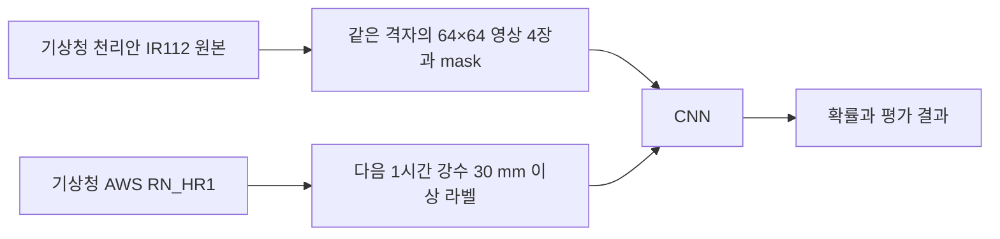

# 천리안 2A + 직접 관측 강수로 다음 1시간 폭우 CNN

서울 ASOS/AWS **108 관측소**에서 앞으로 1시간 동안 강수량이 **30 mm 이상**일 확률을 예측하는 실험이다. 이 기준은 이번 실험의 이진 라벨이며 공식 호우특보 판정을 대신하지 않는다. 기존 DSDS 파이프라인과 별도의 로컬 환경에서 실행한다.

## 입력과 정답



- 예측 시점 `t`의 영상 이력은 `t-3h`, `t-2h`, `t-1h`, `t`다. 정확한 시각이 없는 영상은 보간하거나 반올림하지 않는다.
- 정답은 관측 시각 `t+1h`의 `RN_HR1`, 즉 `(t,t+1h]`의 누적 강수다. `RN_HR1_MI=-60`, `RN_60M_QCM=60`인 값만 채택한다. 결측·음수·불완전 누적은 0 mm로 바꾸지 않는다.
- 영상은 관측소를 중심으로 한 원천 2 km 격자 64×64(약 128 km 문맥)다. 원시 13-bit DN을 `8191`로 나누고, 결측·상위 비트 제외 mask를 별도 채널로 둔다. 4장 × DN·mask = **8×64×64** 입력이다. Kelvin 변환은 하지 않았다. 구름은 CNN의 관측 신호로 유지하며 mask는 결측·코드 범위만 구분한다.
- 강수 관측은 현재 정답 생성에 사용한다. 기온·습도 등 추가 입력은 실제 제공 시각이 예측 시점 이전임을 검증한 경우에만 허용한다. 과거 아카이브에는 그 시각이 없어 기본 CNN은 영상 입력만 쓴다.
- 서울 108 한 지점의 정답이다. 서울 모든 행정동의 강수를 나타내거나 픽셀별 강수 지도를 만드는 모델은 아니다.

## 실행 환경

저장소 루트에서 다음을 실행한다. 이미 설치한 환경이 있으면 재사용한다.

```bash
python3 -m venv sideprojects/gk2a_rain_cnn/.venv
sideprojects/gk2a_rain_cnn/.venv/bin/python -m pip install -r sideprojects/gk2a_rain_cnn/requirements.txt
```

저장소 `.env`의 `KMA_API_KEY`를 사용한다. 기상청 API허브에서 **천리안 2A 기본관측자료**와 **AWS 시간통계 자료 조회** 활용신청이 필요하다. 키는 URL·로그·관리대장·Git에 저장하지 않는다.

## 실제 자료 시험 재현

```bash
sideprojects/gk2a_rain_cnn/.venv/bin/python sideprojects/gk2a_rain_cnn/run_pilot.py --run-name my-pilot
```

`pilot-plan.json`의 세 날짜만 수집한다. 날마다 강수 24시간과 영상 이력 27시간이며 원본·checksum을 확인해 재사용한다. 기존 DSDS Bronze도 시각과 해시가 일치하면 재사용한다. 이미 존재하는 학습 결과 폴더는 덮어쓰지 않는다.

이번 계획은 2024-07-17, 2024-07-23, 2025-08-13의 **사건 선택 시험**이다. 강수를 확인한 뒤 양성이 있는 날짜를 선택했으므로 일반적인 발생률·예측 성능을 추정할 표본이 아니다. 기본 전수 실험의 split과 구분해 `pilot-splits.json`을 사용하고 `--pilot-run` 상태를 결과에 기록한다.

직접 실행한 최초 시험 결과는 [검수 기록](reports/pilot-20261123/README.md)에 있다. 실제 자료 69개(학습·검증·시험 각각 23개), 폭우 양성은 각각 2·1·1개다. CNN 학습·저장·검증 과정이 동작하는지 확인한 결과이며, 성능을 입증한 모델은 아니다.

## 기간 수집과 개별 처리

```bash
# KST 구간 [start,stop). 기본 요청 상한은 72시간이다.
sideprojects/gk2a_rain_cnn/.venv/bin/python sideprojects/gk2a_rain_cnn/collect.py weather --start 2024-07-01T00:00:00+09:00 --stop 2024-08-01T00:00:00+09:00 --limit 744
sideprojects/gk2a_rain_cnn/.venv/bin/python sideprojects/gk2a_rain_cnn/collect.py satellite --start 2024-07-01T00:00:00+09:00 --stop 2024-08-01T00:00:00+09:00 --limit 744

sideprojects/gk2a_rain_cnn/.venv/bin/python sideprojects/gk2a_rain_cnn/dataset.py patches --manifest sideprojects/gk2a_rain_cnn/data/collected/source_manifest.csv
sideprojects/gk2a_rain_cnn/.venv/bin/python sideprojects/gk2a_rain_cnn/dataset.py samples --patch-manifest sideprojects/gk2a_rain_cnn/data/prepared/patch_manifest.csv --station-csv sideprojects/gk2a_rain_cnn/data/collected/station.csv

sideprojects/gk2a_rain_cnn/.venv/bin/python sideprojects/gk2a_rain_cnn/train.py --samples sideprojects/gk2a_rain_cnn/data/prepared/samples.csv --output sideprojects/gk2a_rain_cnn/runs/full-experiment
```

기본 split은 2024년 학습, 2025년 상반기 검증, 2025년 하반기 시험이다. 각 split 시작 전 영상과 종료 뒤 정답이 섞이지 않도록 경계 표본을 제외한다. 클래스당 표본이 부족하면 학습을 중단한다. 위 한 달 수집 예시는 수집 명령의 예이며 기본 세 split 학습 자료를 모두 충족하지는 않는다. 기간을 확장하고 양성 수를 확인해야 한다.

대규모 수집 전에 시간 범위·API 요청 수·저장량을 확인한다. 기본 요청 상한과 4개 이하 worker, 요청 간격 제한, 재시도, 시각·제품·checksum 검사를 둔다. 계정의 추가 쿼터는 별도 확인한다. 다른 프로세스에서 같은 출력 폴더에 동시에 수집하지 않는다.

## 파일과 검증

`data/collected/bronze/`에 실제 API 응답과 원본을 보존한다. `station.csv`, `source_manifest.csv`는 그 파일·해시와 연결된다. `data/prepared/`는 native DN patch·mask·계보·시간 정렬 표본을 저장한다. `runs/<name>/`는 `model.pt`, 설정, 학습 이력, 평가와 시험 예측을 담는다. 이 대용량·런타임 자료와 전용 환경은 Git 제외다. 검수 요약과 재현 코드를 커밋한다.

검증 AP로 checkpoint를 선택하고 확률 판정 기준은 검증 F1로만 정한다. 시험 자료는 마지막에 한 번 평가한다. 클래스 가중치와 수치 자료의 결측 보완·정규화도 학습 구간에서만 계산한다. 단일 클래스에는 AP 등을 null로 표시한다. 작은 클래스 수를 허용하려면 명시적으로 `--pilot-run`이 필요하다.

```bash
sideprojects/gk2a_rain_cnn/.venv/bin/python -m unittest discover -s sideprojects/gk2a_rain_cnn -p 'test_*.py' -v
```

원천 픽셀과 행정동 중첩이 있으므로 기존 425개 동 TIFF를 독립 영상 425장처럼 세지 않는다. 기존 일별 대표 731장만으로 연속 시간 이력을 만들 수도 없다. 실제 영상 수집을 추가한다. 영상의 파일명 시각은 사용하지만 실제 배포 지연·노출 종료 시각까지 검증한 실시간 실험은 아니다. 구름·그림자 QC와 물리량 보정도 별도 과제다.

## 공식 근거

- [AWS 시간통계와 RN_HR1·품질 필드](https://apihub.kma.go.kr/apiList.do?seqApi=2&seqApiSub=239)
- [천리안 2A 자료 API](https://apihub.kma.go.kr/apiList.do?seqApi=6)
- [서울 108 관측소 위치](https://data.kma.go.kr/tmeta/stn/selectStnDetail.do?isSelectStn=Y&pgmNo=82&stdStnNo=108)
